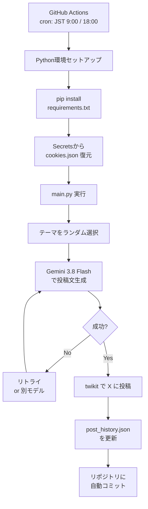

<div align="center">

# 🤖 X Auto Post Bot

**Gemini × twikit × GitHub Actions で動く、完全無料のX自動投稿Bot**

[](https://www.python.org/)
[](https://github.com/features/actions)
[](https://aistudio.google.com/)
[](./LICENSE)

*PCの電源を切っていても、毎日自動で投稿が続く。*

</div>

---

## 📖 目次

- [✨ 特徴](#-特徴)
- [🔄 動作の流れ](#-動作の流れ)
- [🚀 クイックスタート](#-クイックスタート)
- [⚙️ 環境変数](#️-環境変数)
- [🎨 カスタマイズ](#-カスタマイズ)
- [🩺 トラブルシューティング](#-トラブルシューティング)
- [🔒 セキュリティ](#-セキュリティ)
- [⚠️ 免責事項](#️-免責事項)

---

## ✨ 特徴

| | 特徴 | 詳細 |
|---|---|---|
| 💸 | **完全無料** | GitHub Actions（Publicリポジトリ）+ Gemini無料枠 + twikit で月額0円 |
| 🧠 | **AIが文面を自動生成** | Gemini 3.8 Flash がテーマに沿った投稿文を作成 |
| 🔁 | **自動リトライ＆フォールバック** | 503/429エラー時は指数バックオフで再試行、別モデルへ自動切替 |
| ☁️ | **サーバー不要** | GitHub Actionsのcronで定時実行。PCは不要 |
| 🔐 | **Cookieセッション認証** | 公式APIキー不要。ブラウザのCookieをSecretsで安全に管理 |
| 📝 | **投稿履歴の永続化** | `post_history.json` をリポジトリに自動コミット |
| 🎯 | **テーマ自由設定** | `TOPICS` リストを編集するだけで投稿内容を変更可能 |

---

## 🔄 動作の流れ



---

## 🚀 クイックスタート

### 1. リポジトリをクローン

```bash
git clone https://github.com/mazika1u/x-auto-bot.git
cd x-auto-bot
```

### 2. 依存ライブラリをインストール

```bash
python -m venv venv

# Windows
.\venv\Scripts\Activate.ps1

# Mac / Linux
source venv/bin/activate

pip install -r requirements.txt
```

### 3. APIキーとCookieを取得

| 項目 | 取得方法 |
|---|---|
| **Gemini APIキー** | [Google AI Studio](https://aistudio.google.com/) → 「Get API key」 |
| **XのCookie** | x.com にログイン → F12 → Network → `cookie:` ヘッダーをコピー |

### 4. `.env` を作成

```bash
cp .env.example .env
```

`.env` を編集：

```env
GEMINI_API_KEY=AIza...
```

### 5. `cookies.json` を作成

Cookieヘッダー文字列をJSONに変換します。

```python
import json
cookie_header = "auth_token=...; ct0=...; ..."
cookies = dict(p.split("=", 1) for p in cookie_header.split("; ") if "=" in p)
json.dump(cookies, open("cookies.json", "w"), indent=2)
```

### 6. ローカルでテスト

```bash
python main.py
```

Xのタイムラインに投稿が表示されれば成功です 🎉

### 7. GitHub Actionsを有効化

1. GitHubのリポジトリ → **Settings → Secrets and variables → Actions**
2. 以下の2つを登録：

| Secret名 | 値 |
|---|---|
| `GEMINI_API_KEY` | GeminiのAPIキー |
| `COOKIES_JSON` | `cookies.json` の中身を1行JSONにしたもの |

3. **Actions** タブ → **X Auto Post** → **Run workflow** で手動テスト

---

## ⚙️ 環境変数

| 変数名 | 必須 | 説明 |
|---|---|---|
| `GEMINI_API_KEY` | ✅ | Google AI Studioで発行したAPIキー |
| `COOKIES_JSON` | ✅ | XのセッションCookie（1行JSON） |

---

## 🎨 カスタマイズ

### 投稿テーマを変更する

`main.py` の `TOPICS` を編集：

```python
TOPICS = [
    "今日のAI・テクノロジーに関する豆知識を1つ紹介してください。",
    "Pythonプログラミングの便利なTipsを1つ共有してください。",
    "読書から得た学びを1つ共有してください。",  # 追加
]
```

### 投稿スケジュールを変更する

`.github/workflows/auto_post.yml` の `cron` を編集（**UTC基準**、JST = UTC+9）：

```yaml
on:
  schedule:
    - cron: '0 0 * * *'   # JST 9:00
    - cron: '0 9 * * *'   # JST 18:00
```

### 使用モデルを変更する

`main.py` の `MODELS` を編集：

```python
MODELS = [
    "gemini-3.8-flash",
    "gemini-3.6-flash",
    "gemini-3.5-flash",
]
```

---

## 🩺 トラブルシューティング

<details>
<summary><b>🔴 ModuleNotFoundError: No module named 'twikit.client'</b></summary>

PyPI公式の `twikit` が破損しています。`requirements.txt` を以下に修正してください。

```
twifork
google-genai
python-dotenv
```
</details>

<details>
<summary><b>🔴 503 Service Unavailable</b></summary>

Gemini APIの一時的な高負荷です。`main.py` のリトライ＆フォールバック機構が自動で対処します。頻発する場合は `cron` の実行頻度を下げてください。
</details>

<details>
<summary><b>🔴 401 Unauthorized</b></summary>

Cookieが期限切れです。ブラウザで再ログインし、最新のCookieを取得して `COOKIES_JSON` Secretを更新してください。
</details>

<details>
<summary><b>🔴 GitHub Actionsが起動しない</b></summary>

- ワークフローファイルが `main` ブランチにプッシュされているか確認
- リポジトリに60日間コミットがないとcronが自動停止します。手動実行で再開できます
</details>

<details>
<summary><b>🔴 post_history.json のコンフリクト</b></summary>

GitHub Actionsが自動更新するため、ローカルと競合することがあります。プッシュ前に以下を実行してください。

```bash
git pull --rebase origin main
```
</details>

---

## 🔒 セキュリティ

- `.env` と `cookies.json` は **絶対にGitにコミットしないでください**（`.gitignore` で除外済み）
- `COOKIES_JSON` は GitHub Secrets に保存され、ログ上でもマスクされます
- Cookieはパスワードと同等の資格情報です。漏洩の疑いがあれば、Xの設定から **すべてのセッションをログアウト** してください
- OneDrive等のクラウド同期フォルダにCookieを置く場合は注意してください

---

## ⚠️ 免責事項

> 本プロジェクトは **教育・学習目的** で公開されています。
>
> ブラウザセッションを利用した自動投稿は、Xの利用規約に違反する可能性があり、**アカウント凍結のリスク**があります。利用はすべて**自己責任**でお願いします。
>
> 本コードの使用によって生じたいかなる損害についても、作者は責任を負いません。

---

<div align="center">

**Made with 🤖 and ☕**

このプロジェクトが役に立ったら、⭐をお願いします！
<div align="center">
  <sub><span style="color: #888;">Created by "deepseek" & "mazika1u"</span></sub>
</div>
</div>
